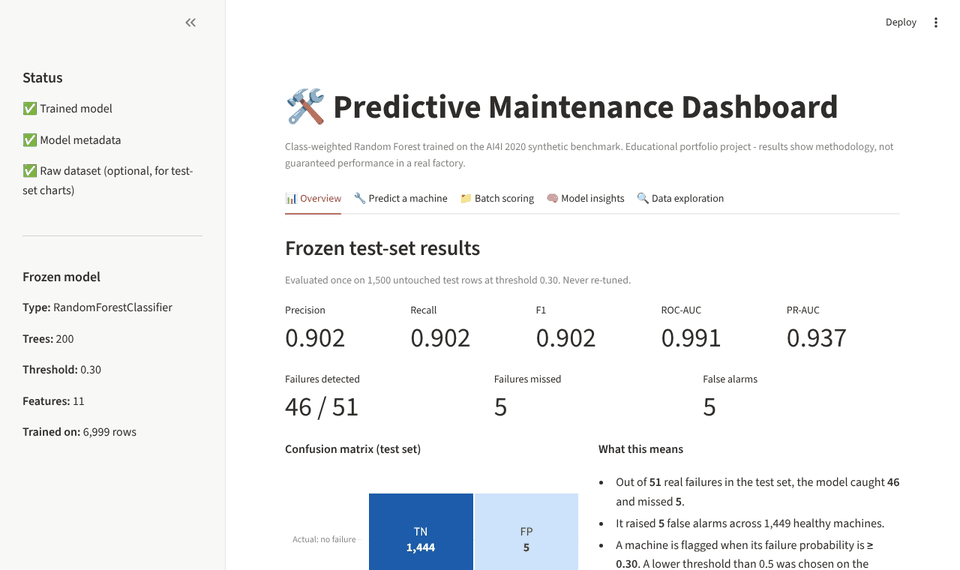
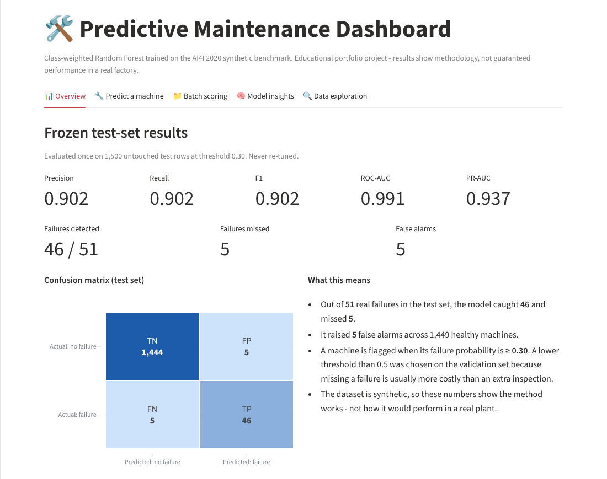

# Predictive Maintenance System Using Machine Learning


[](https://machine-failure-predictor-ai4i.streamlit.app)

An end-to-end machine learning pipeline for predicting industrial machine
failures, built on the AI4I 2020 synthetic predictive-maintenance
benchmark. This is an educational portfolio project demonstrating
reproducible ML engineering practice — data preparation, feature
engineering, model selection, frozen evaluation, modular reusable code,
automated testing, and an interactive Streamlit dashboard.

**Important limitation:** This project uses a synthetic, publicly
available benchmark dataset. It demonstrates methodology, reproducibility,
and engineering practice — it does not prove guaranteed performance in a
real factory environment.

### 🚀 [Live demo →](https://machine-failure-predictor-ai4i.streamlit.app)

Try the dashboard in your browser — no installation needed. (Hosted on the
free Streamlit Community Cloud tier, so the first load after a quiet period
can take ~30 seconds while the app wakes up.)



*Walkthrough: frozen results → single-machine prediction → batch CSV scoring → model insights → data exploration.*

---

## Table of Contents

- [Quick Start](#quick-start)
- [Deploying the Live Demo](#deploying-the-live-demo)
- [Dashboard](#dashboard)
- [Dataset](#dataset)
- [Project Structure](#project-structure)
- [Pipeline Overview](#pipeline-overview)
- [Final Test Evaluation (frozen)](#5-final-test-evaluation-frozen)
- [Reusable Source Modules](#reusable-source-modules)
- [Automated Tests](#automated-tests)
- [Status & Remaining Work](#status--remaining-work)

---

## Quick Start

```bash
# 1. Clone the repository
git clone https://github.com/merinjo90/predictive_maintenance.git
cd predictive_maintenance

# 2. Create and activate a virtual environment
python -m venv .venv
source .venv/bin/activate          # Windows: .venv\Scripts\activate

# 3. Install dependencies
pip install -r requirements.txt

# 4. Download the dataset (not committed - see .gitignore)
#    https://archive.ics.uci.edu/dataset/601/ai4i+2020+predictive+maintenance+dataset
#    Save it as: data/raw/ai4i2020.csv

# 5. Train and save the final model (with a built-in safety check
#    against the frozen Phase 7 metrics)
PYTHONPATH=. python scripts/save_final_model.py

# 6. Run the test suite
python -m pytest

# 7. Launch the dashboard
streamlit run app/dashboard.py
```

The dashboard opens at <http://localhost:8501>.

> **Use the pinned library versions.** The frozen results reproduce exactly
> with `scikit-learn==1.7.2`, `pandas==2.3.3` and `numpy==2.2.6` (as in
> `requirements.txt`). Newer versions (e.g. scikit-learn 1.9 / pandas 3)
> train a slightly different forest, and the safety check will correctly
> refuse to save it.

---

## Dashboard



`app/dashboard.py` is a Streamlit app built on top of the same tested
`src/` modules used for training — it does not duplicate any
preprocessing logic, and it never retrains or retunes the model on its own.

| Tab | What it does |
|---|---|
| 📊 **Overview** | Frozen test-set metrics (precision, recall, F1, ROC-AUC, PR-AUC), confusion matrix, and a plain-language explanation of the results |
| 🔧 **Predict a machine** | Enter one machine's readings (type, temperatures, speed, torque, tool wear) and get a failure probability, a status (Normal / Watch / Failure predicted), the engineered feature values, and a *what-if* curve showing how the probability changes as one reading varies |
| 📁 **Batch scoring** | Upload a CSV (the raw AI4I format works as-is, or use the template), score every row, filter to flagged machines, and download the results |
| 🧠 **Model insights** | Random Forest feature importance, plus a threshold explorer showing how precision / recall / F1 trade off and how predicted probabilities are distributed for failures vs. normal machines |
| 🔍 **Data exploration** | Dataset summary, failure-mode counts, raw and cleaned data previews, and the saved EDA charts from `reports/figures/` |

**What the dashboard needs:**

- `models/model_metadata.json` — committed; required
- `models/random_forest_final.joblib` — committed (≈4 MB) so the live demo
  can load it; can be regenerated with `scripts/save_final_model.py`. If the
  dataset is present but the model is not, the sidebar offers a
  **Train & save model** button (same safety check).
- `data/raw/ai4i2020.csv` — optional; enables the threshold explorer and
  the dataset charts. Every other tab works without it.

**Status levels:**

| Status | Rule |
|---|---|
| ⛔ Failure predicted | probability ≥ 0.30 (the frozen model threshold) |
| ⚠️ Watch | probability ≥ 0.15 — display-only early warning, does not change the model's prediction |
| ✅ Normal | probability < 0.15 |

> The threshold explorer uses the test set purely for illustration. The
> frozen threshold (0.30) was selected on the validation set and is not
> changed by the dashboard.

**Re-recording the demo GIF:**
`scripts/record_dashboard_gif.py` drives the running dashboard with
Playwright, screenshots each step and stitches them into
`docs/dashboard_demo.gif`.

```bash
pip install playwright pillow       # dev-only tools
playwright install chromium
streamlit run app/dashboard.py      # terminal 1
python scripts/record_dashboard_gif.py   # terminal 2
```

---

## Deploying the Live Demo

The live demo runs on [Streamlit Community Cloud](https://share.streamlit.io)
(free). To deploy your own copy:

1. Sign in at <https://share.streamlit.io> with GitHub.
2. Click **Create app** → **Deploy a public app from GitHub**.
3. Fill in:
   - **Repository:** `merinjo90/predictive_maintenance`
   - **Branch:** `main`
   - **Main file path:** `app/dashboard.py`
   - **App URL:** `machine-failure-predictor-ai4i`
4. Open **Advanced settings** and choose **Python 3.12** (or 3.13).
5. Click **Deploy**.

Deployment notes:

- Community Cloud installs packages from **`app/requirements.txt`** (it
  looks next to the entrypoint first). That file holds only the six
  libraries the dashboard needs, with the model libraries pinned to the
  training versions. The full root `requirements.txt` (Jupyter, XGBoost,
  GPU libraries…) is for local development only.
- The dataset is not in the repository, so the online demo hides the
  threshold explorer and dataset charts and shows the saved EDA images
  instead. Every other tab works fully.
- Pushing to `main` redeploys the app automatically.

---

## Dataset

- Source: [AI4I 2020 Predictive Maintenance Dataset](https://archive.ics.uci.edu/dataset/601/ai4i+2020+predictive+maintenance+dataset) (UCI, synthetic)
- 10,000 rows × 14 columns
- No missing values, no duplicate rows
- Target: `Machine failure` (binary)
- Class distribution: 9,661 normal rows, 339 failure rows (3.39% failure rate)

---

## Project Structure

```
predictive_maintenance/
├── app/
│   ├── dashboard.py          # Streamlit dashboard
│   ├── requirements.txt      # lean dependencies for the live demo
│   └── main.py               # (planned) FastAPI serving layer
├── data/                     # not committed
│   ├── raw/                  # original AI4I 2020 CSV
│   └── processed/            # processed data artifacts
├── docs/
│   ├── dashboard_demo.gif    # animated walkthrough
│   └── dashboard_overview.png
├── models/
│   ├── random_forest_final.joblib   # frozen trained model (used by the live demo)
│   ├── model_metadata.json   # frozen params, threshold, feature names, metrics
│   └── README.md             # model reproducibility notes
├── notebooks/
│   └── 01_data_exploration.ipynb   # EDA, feature engineering, model comparison
├── reports/figures/          # saved EDA charts
├── scripts/
│   ├── save_final_model.py   # deterministic training + save, with safety check
│   └── record_dashboard_gif.py   # records docs/dashboard_demo.gif
├── src/
│   ├── data_processing.py    # load, clean, encode, split
│   ├── features.py           # engineered feature logic
│   ├── train_model.py        # frozen model training
│   ├── evaluate.py           # metric computation
│   └── predict.py            # inference on new data
├── tests/                    # pytest suite (34 tests)
├── Dockerfile                # (planned)
└── requirements.txt
```

---

## Pipeline Overview

### 1. Exploratory Data Analysis
The raw AI4I 2020 dataset was loaded and verified: 10,000 rows, 14
columns, no missing values, and no duplicate rows. Class imbalance was
identified early — only 3.39% of rows represent an actual machine failure
(339 out of 10,000) — and documented as a key constraint shaping every
later modeling decision, since a naive classifier could reach 96%+
"accuracy" just by predicting no failure every time. Correlations between
sensor readings, distributions split by failure class, and the five
individual failure-type columns (`TWF`, `HDF`, `PWF`, `OSF`, `RNF`) were
all reviewed to understand what patterns actually preceded a failure, with
each observation saved as a chart for later reference.

### 2. Data Preparation
Identifier columns (`UDI`, `Product ID`) were dropped since they're
arbitrary row labels with no predictive signal. The five failure-type
columns were excluded from the feature set entirely — not because they're
uninteresting, but because they describe *how* a failure occurred after
the fact, which would leak the answer into the model rather than let it
predict failure in advance. The categorical `Type` column was one-hot
encoded into `Type_H`, `Type_L`, and `Type_M`, and the cleaned data was
split into stratified train/validation/test sets (6,999 / 1,501 / 1,500
rows respectively) so the same ~3.39% failure rate is preserved across all
three splits. A fixed `random_state=42` was used for every split, so the
exact same rows land in train/val/test on any re-run.

### 3. Feature Engineering
Three engineered features were derived from the raw sensor readings to
give the model more physically meaningful signal than the raw columns
alone provide. `Power` combines torque and rotational speed into a
mechanical power estimate; `Temp_diff` captures the temperature gap
between the process and the surrounding air, which tends to widen under
stress; and `Wear_Torque` combines tool wear and torque to approximate
cumulative mechanical strain. These three features were computed with the
same formulas and applied consistently across all three splits, so there's
no risk of the train, validation, and test sets being engineered
differently from one another.

| Feature | Formula |
|---|---|
| `Power` | `Torque [Nm] × Rotational speed [rpm] × (2π / 60)` |
| `Temp_diff` | `Process temperature [K] − Air temperature [K]` |
| `Wear_Torque` | `Tool wear [min] × Torque [Nm]` |

### 4. Model Selection
Several approaches were compared, evaluated only on the validation set so
the test set stayed completely untouched during this process: a
majority-class baseline (to establish a floor), Logistic Regression, a
class-weighted Random Forest, the same Random Forest combined with SMOTE
oversampling, and XGBoost. A threshold sweep was also run on the
class-weighted Random Forest to find the decision threshold that best
balanced precision and recall, since the default 0.50 threshold favored
precision far more than recall on this imbalanced dataset. The
class-weighted Random Forest at threshold 0.30 gave the strongest recall
and F1 trade-off of everything tested, which is what made it the selected
model going into final evaluation.

### 5. Final Test Evaluation (frozen)
The selected model — and only that model, with its already-chosen
hyperparameters and threshold — was evaluated exactly once on the
untouched 1,500-row test set that had never been seen during training,
validation, or threshold tuning. Those results were then frozen: no
further tuning, model swapping, or threshold adjustment is permitted
afterward, since doing so would mean the test set was no longer a genuine
measure of out-of-sample performance. The metrics reported below are that
one-time evaluation, and they're the most honest available answer to "how
well does this actually work" for this project.

**Model configuration:**
- Class-weighted Random Forest
- `n_estimators = 200`
- `threshold = 0.30`
- `random_state = 42`

**Test-set metrics:**

| Metric | Value |
|---|---|
| Precision | 0.9020 |
| Recall | 0.9020 |
| F1 | 0.9020 |
| ROC-AUC | 0.9910 |
| PR-AUC | 0.9371 |

**Confusion matrix:**

|  | Predicted: No failure | Predicted: Failure |
|---|---|---|
| **Actual: No failure** | 1,444 (TN) | 5 (FP) |
| **Actual: Failure** | 5 (FN) | 46 (TP) |

Out of 51 real failures in the test set, 46 were detected, 5 were missed,
and 5 false alarms were raised.

---

## Reusable Source Modules

The full pipeline was refactored out of the exploratory notebook into
tested, reusable modules:

| Module | Purpose |
|---|---|
| `src/data_processing.py` | Loads the raw CSV, drops identifiers, excludes leakage columns, one-hot encodes `Type`, and produces the stratified train/val/test split |
| `src/features.py` | Adds the `Power`, `Temp_diff`, and `Wear_Torque` engineered features, single-dataframe and multi-split versions |
| `src/train_model.py` | Trains the frozen class-weighted Random Forest with fixed hyperparameters |
| `src/evaluate.py` | Computes precision, recall, F1, ROC-AUC, PR-AUC, and confusion-matrix breakdown at the frozen threshold |
| `src/predict.py` | Loads the saved model and metadata (or accepts injected ones) and produces predictions on new, already-cleaned data |
| `app/dashboard.py` | Streamlit UI; its input-validation and scoring helpers (`prepare_input`, `score_dataframe`, `risk_level`, `metrics_at_threshold`) are plain functions covered by tests |

`scripts/save_final_model.py` retrains the model deterministically and
includes a built-in safety check: it compares the freshly trained model's
metrics against the frozen Phase 7 results and only saves the model if
they match exactly.

---

## Automated Tests

34 tests across 6 files, all passing:

| Test file | Tests | Covers |
|---|---|---|
| `test_data_processing.py` | 7 | Identifier/leakage column exclusion, `Type` encoding, split sizes, stratification, end-to-end pipeline |
| `test_features.py` | 6 | Engineered feature formulas, non-mutation of input, multi-split application |
| `test_train_model.py` | 4 | Fitted model returned, frozen hyperparameters, training determinism, valid prediction labels |
| `test_evaluate.py` | 5 | Metric dict shape, default threshold, confusion-matrix correctness, alias-field consistency, row count |
| `test_predict.py` | 5 | Result dict shape, metadata-driven threshold, engineered features applied before scoring, threshold-based prediction, feature-name order alignment |
| `test_dashboard.py` | 7 | Raw/encoded input handling, all three `Type` columns always created, clear errors for missing columns and unknown types, status bands, threshold metrics |

Run the full suite with:

```bash
python -m pytest
```

> Note: use `python -m pytest`, not a bare `pytest` command — this
> guarantees the test run uses the active virtual environment's installed
> pytest rather than any other `pytest` that might be earlier on `PATH`.

---

## Status & Remaining Work

**Completed:**
- Exploratory data analysis
- Data preparation and stratified splitting
- Feature engineering
- Model comparison and selection
- Frozen final test evaluation
- Reusable, tested source modules
- Full automated test suite (34 tests)
- Streamlit dashboard (single prediction, batch scoring, model insights, EDA)
- Live demo on Streamlit Community Cloud

**Not yet implemented:**
- FastAPI serving layer (`app/main.py`)
- Docker integration

---

## License

This project is for educational and portfolio purposes. The AI4I 2020
dataset is a publicly available synthetic benchmark.
